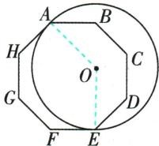

> [!success]- 必刷题
>
> > [!success] **【答案】** $135^{\circ}$
>
> > [!note]- **【解析】**
> > 如图, 连接 OA, OE. $\because \odot O$ 与正八边形 ABCDEFGH 相切于点 A, E, $\therefore \angle OAH = \angle OEF = 90^{\circ}$ . $\because$ 六边形 AHGFEO 的内角和为 $(6-2) \times 180^{\circ} = 720^{\circ}, \angle H = \angle G =$
> >
> > $\angle F=(8-2)\times180\div8=135^{\circ},\therefore\angle AOE=720^{\circ}-90^{\circ}\times2-135^{\circ}\times3=135^{\circ},$ ∴ $\widehat{AE}$ 的度数为 $135^{\circ}$ ，故答案为 $135^{\circ}$ .
> >
> > 
