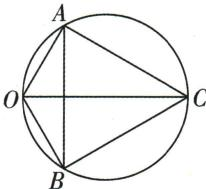
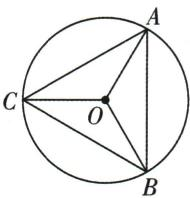

> [!success]- 必刷题
>
> > [!success] **【答案】** 3, 4, 5
>
> > [!note]- **【解析】**
> > ∵ $\angle AOB = 120^{\circ}$ , $\angle ACB = 60^{\circ}$ , ∴ ①当点 C 在 $\triangle ABO$ 的外接圆上，且点 C 在优弧 $\widehat{AB}$ 上， $\angle OAC = 90^{\circ}$ 时，OC 长度的值最大，如图 (1). ∵ $OA = 2\sqrt{2}$ , $\angle ACO = \angle ABO = \frac{1}{2}(180^{\circ} - \angle AOB) = 30^{\circ}$ , ∴ OC = $2OA = 2 \times 2\sqrt{2} = 4\sqrt{2}$ .
> >
> > 
> > 图(1)
> >
> > 
> > 图(2)
> > - **②**：当点 C 在以 O 为圆心、OA 为半径的圆上时，OC 长度的值最小，如图(2)，则 OC = OA = $2\sqrt{2}$ ，∴ $2\sqrt{2} \leqslant OC \leqslant 4\sqrt{2}$ 。∵ OC 的长度为整数，∴ OC 长度的可能值为 3, 4, 5，故答案为 3, 4, 5。
> >
> > 思路分析
> > 以 AD 所在的直线为对称轴, 作正方形 ABCD 的对称图形正方形 ANMD, 连接 GM, 可得 $DH = \frac{1}{2} GM$ ,
> > 证明 $\triangle ABE \cong \triangle DAF$ 可得 $\angle AGB = 90^{\circ}$ ，即点 G 在以 AB 为直径的圆上，从而可得点 G 在 OM 上时，GM 最短。利用勾股定理求得 OM 的长，进而求出 GM 和 DH 的长。
