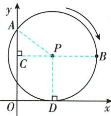
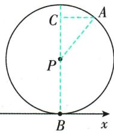

> [!success]- 必刷题
>
> > [!success] **【答案】** (14+5π,18)
>
> > [!note]- **【解析】**
> > 如图(1)，连接AP，PB，过点P作PC⊥y轴于点C，PD⊥x轴于点D. ∵ P(8,10)，∴ PD=OC=10，PC=OD=8. ∵ ⊙P与x轴相切，∴ PA=PB=PD=10，∴ AC=√10²-8²=6，∴ OA=OC+AC=16，∴ A(0,16). ∵ 点B的横坐标为18，PC+PB=18，∴ 点P，B在平行于x轴的同一条直线上，即B(18,10)，∴ ∠BPD=90°，∴ BD 的长为 $\frac{90\pi\times10}{180}=5\pi$ . 当点B第一次落在x轴上时，点P移动的距离为BD的长，∴ 此时点P的坐标为(8+5π,10)，当⊙P沿着x轴向右作无滑动的滚动时，AB 的长度保持不变，∴ 点A转动到如图(2)所示的位置. ∵ AC=6，PC=8，∴ BC=PB+PC=18，∴ A(8+5π+6,18)，即A(14+5π,18). 故答案为(14+5π,18).
> >
> > 解题的关键是确定点 B 第一次落在 x 轴上时, 点 P 和点 A 的位置, 以及明确旋转过程中 $\widehat{AB}$ 的长度不变.
> >
> > ## 关键点拨
> >
> > ## 关键点拨
> >
> > 运用圆锥的侧面积公式 $S_{侧面}=\pi rl(r$ 为底面圆的半径，l为圆锤的母线长）求解是解题的关键.
> >
> > 
> > 图(1)
> >
> > 
> > 图(2)
