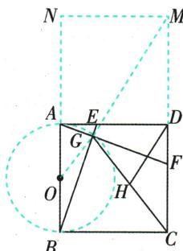

> [!success]- 必刷题
>
> > [!success] **【答案】** $\frac{\sqrt{13} - 1}{2}$
>
> > [!note]- **【解析】**
> > 如图, 以 $AD$ 所在的直线为对称轴, 作正方形 $ABCD$ 的对称图形正方形 $ANMD$ , 连接 $GM$ , $\therefore MD=CD, MN=AD=2$ , $\angle N=90^{\circ}$ . $\because H$ 为 $GC$ 的中点, $\therefore HD$ 为 $\triangle GMC$ 的中位线, $\therefore DH=\frac{1}{2}GM$ , $\therefore$ 当 $GM$ 最
> >
> > 短时, DH 最短. ∵ 四边形 ABCD 是正方形, $\therefore BA = AD, \angle BAE = \angle ADF = 90^{\circ}.$ $\because AE = DF, \therefore \triangle ABE \cong \triangle DAF,$ $\therefore \angle ABE = \angle DAF.$ $\because \angle BAD = \angle BAG + \angle DAF = 90^{\circ}, \therefore \angle ABE +$
> >
> > 
> >
> > $\angle BAG = 90^{\circ}, \therefore \angle AGB = 90^{\circ}, \therefore$ 点 $G$ 在以 $AB$ 为直径的圆 $O$ 上. 连接 $OG$ . $\because GM \geqslant OM - OG$ , $\therefore$ 当点 $G$ 在 $OM$ 上时, $GM$ 最短. $\because OM = \sqrt{ON^{2} + MN^{2}} = \sqrt{3^{2} + 2^{2}} = \sqrt{13}$ , $\therefore GM = OM - OG = \sqrt{13} - 1$ , $\therefore DH = \frac{1}{2} GM = \frac{\sqrt{13} - 1}{2}$ , 故答案为 $\frac{\sqrt{13} - 1}{2}$ .
