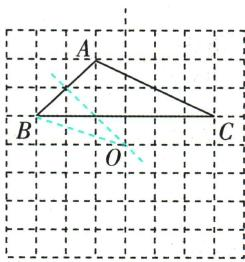
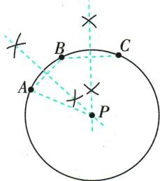

> [!success]- 必刷题
>
> > [!success] **【答案】** $\sqrt{10}$
>
> > [!note]- **【解析】**
> > 【解】(1)如图(1)所示,点 O 即为所求.外接圆半径 $OB=\sqrt{1^{2}+3^{2}}=\sqrt{10}$ . 故答案为 $\sqrt{10}$ .
> > (2) 如图(2)所示, $\odot P$ 即为所求.
> >
> > 
> > 图(1)
> >
> > 
> > 图(2)
