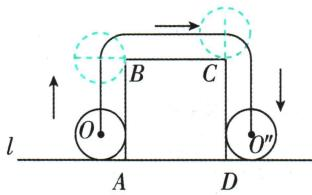

> [!success]- 必刷题
>
> > [!success] **【答案】** 详见解析
>
> > [!note]- **【解析】**
> > 【解】(1) 圆 O 扫过的面积为 $\pi \times \left(\frac{4}{2}\right)^{2} + 4 \times (8 + 4) = (48 + 4\pi) \, \text{cm}^{2}$ ，这个过程共用了 $(4 + 8) \div 2 = 6$ （秒）.
> >
> > (2) 圆 $O$ 在滚动过程中, 圆心 $O$ 的运动路线如图所示, 则圆心 $O$ 经过的路程是
> >
> > 
> >
> > (8-2)×2+8+2× $\frac{1}{4}$ × $\pi$ ×4=(20+2 $\pi$ )cm.
