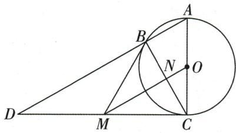

<!-- question-source:start -->
1[2025 江苏盐城期中, 中]如图, $\odot O$ 是直角三角形 $ABC$ 的外接圆, 直径 $AC = 4$ , 过 $C$ 点作 $\odot O$ 的切线, 与 $AB$ 延长线交于点 $D, M$ 为 $CD$ 的中点, 连接 $BM, OM$ , 且 $BC$ 与 $OM$ 相交于点 $N$ .

(1) 求证: BM 与 $\odot O$ 相切;

(2) 当 $\angle A = 60^{\circ}$ 时, 在 $\odot O$ 上取点 F, 使 $\angle ABF = 15^{\circ}$ , 补全图形, 并求点 F 到直线 AB 的距离.

<!-- question-source:end -->

![[Q00106926A1]]
