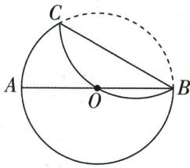

<!-- question-source:start -->
5[2024 江苏扬州校级质检, 中] 如图, AB 是 $\odot O$ 的直径, BC 是 $\odot O$ 的弦, BC = 3, 将 $\widehat{BC}$ 沿着 BC 折叠后恰好经过点 O, 则 AB 的长为 \_\_\_\_

<!-- question-source:end -->

![[Q00106930A1]]
