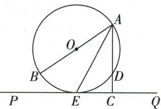

<!-- question-source:start -->
6[中]如图,AB为 $\odot O$ 的直径,PQ是 $\odot O$ 的切线,E为切点, $AC\perp PQ$ 于C,交 $\odot O$ 于D.

(1) 求证: AE 平分 $\angle BAC$ ;

(2) 若 $AD = EC = 2$ , 求 $\odot O$ 的半径.

<!-- question-source:end -->

![[Q00106931A1]]
