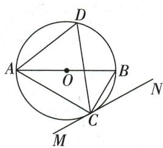

<!-- question-source:start -->
7 [2025 山东青岛期中, 中]如图, $AB$ 为 $\odot O$ 的直径, $C, D$ 为 $\odot O$ 上的点, 直线 $MN$ 切 $\odot O$ 于 $C$ 点, 图中与 $\angle BCN$ 互余的

角有 （ ）A.1个 B.2个 C.3个 D.4个

建议用时 40 分钟 答案 D63
<!-- question-source:end -->

![[Q00106932A1]]
