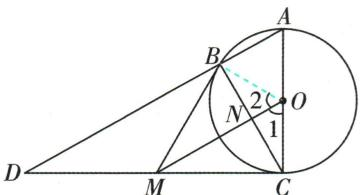
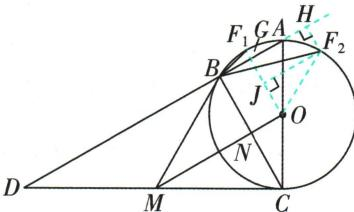

> [!success]- 必刷题
>
> > [!success] **【答案】** (1)
>
> > [!note]- **【解析】**
> > 【证明】连接 OB, 如图(1).
> >
> > 
> > 图(1)
> >
> > 思路分析
> > 连接 AC, 根据直角所对的弦为直径, 以及同弧所对的圆周角相等, 得到 AC 为直径, $\angle CAB = 30^{\circ}$ , 进而求出 AC 的长, 即可得到 $\odot O$ 的半径.
> >
> > ∵ M 为 CD 的中点, O 是 AC 中点, ∴ OM 是 △ACD 的中位线, ∴ OM∥AD. ∵ AC 是 ⊙O 的直径, ∴ ∠ABC = 90°, ∴ OM⊥BC. ∵ OB = OC, ∴ ∠1 = ∠2. 又 ∵ OM = OM, ∴ △OBM ≅ △OCM(SAS), ∴ ∠OBM = ∠OCM. ∵ MC 是 ⊙O 切线, ∴ ∠OCM = 90°, ∴ ∠OBM = 90°, ∴ OB⊥BM. ∵ OB 是 ⊙O 的半径, ∴ BM 与 ⊙O 相切.
> >
> > (2)【解】如图(2)所示,当点 F 在点 A 左侧
> >
> > 时, 连接 $OF_{1}$ ,
> > 交 AB 于点 G. $\because \angle ABF_{1} = 15^{\circ}, \therefore \angle AOF_{1} = 30^{\circ}. \because \angle BAC = 60^{\circ}, \therefore \angle AGO = 90^{\circ}, \therefore OF_{1} \perp$
> >
> > 
> > 图(2)
> >
> > $AB$ . $\because AC = 4, \therefore AO = OF_{1} = 2, \therefore AG = 1, \therefore OG = \sqrt{3}, \therefore F_{1}G = 2 - \sqrt{3}$ . 当点 $F$ 在点 $A$ 右侧时，过点 $F_{2}$ 作 $F_{2}H \perp AB$ 交 $BA$ 延长线于点 $H, F_{2}J \perp OG$ ，垂足为点 $J$ ，连接 $OF_{2}, \therefore$ 四边形 $F_{2}HGJ$ 是矩形. 在 Rt $\triangle F_{2}JO$ 中， $OF_{2} = 2$ . $\because \angle ABF_{2} = 15^{\circ}, \therefore \angle AOF_{2} = 2\angle ABF_{2} = 30^{\circ}, \therefore \angle F_{2}OJ = \angle AOF_{2} + \angle AOF_{1} = 60^{\circ}, \therefore \angle OF_{2}J = 30^{\circ}, \therefore OJ = 1, \therefore F_{2}H = GJ = OG - OJ = \sqrt{3} - 1$ . 综上，点 $F$ 到直线 $AB$ 的距离为 $2 - \sqrt{3}$ 或 $\sqrt{3} - 1$ .
> >
> > 大招解读 | 作直径构造直角三角形
> > 看到圆周角,想到连接弦,若弦是直径即可证圆周角是直角.反之,若圆周角是直角可得弦是直径.
