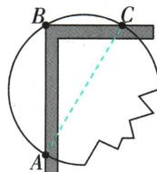

> [!success]- 必刷题
>
> > [!success] **【答案】** $\frac{13}{2}$
>
> > [!note]- **【解析】**
> > 连接 $AC$ , 如图. $\because \angle ABC = 90^{\circ}$ , 且 $\angle ABC$ 是圆周角, $\therefore AC$ 是圆形镜面的直径. 由勾股定理得 $AC = \sqrt{AB^{2} + BC^{2}} = \sqrt{12^{2} + 5^{2}} = 13 (\mathrm{cm}$ 的半径为 $\frac{13}{2} \mathrm{~cm}$ . 故答案为 $\frac{13}{2}$ .
> >
> > 
