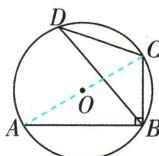

> [!success]- 必刷题
>
> > [!success] **【答案】** A
>
> > [!note]- **【解析】**
> > 如图, 连接 AC, 则 $\angle CAB = \angle BDC = 30^{\circ}$ . $\because AB \perp BC$ , $\therefore \angle ABC = 90^{\circ}$ , $\therefore AC$ 为 $\odot O$ 的直径. $\because \angle ABC = 90^{\circ}$ , $\angle CAB = 30^{\circ}$ , BC = 4, $\therefore AC =$
> >
> > 
> >
> > $2BC = 8, \therefore \odot O$ 的半径为 $\frac{8}{2} = 4$ . 故选 A.
> >
> > 看到弦(不是直径)及过弦的端点的半径,想到作弦心距,构造出直角三角形,然后利用勾股定理解决求线段长的问题.
