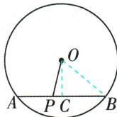

> [!success]- 必刷题
>
> > [!success] **【答案】** D
>
> > [!note]- **【解析】**
> > 如图, 过点 O 作 OC⊥AB 于点 C, 连接 OB, 则 OB = 7. ∵ PA = 4, PB = 6, ∴ AB = PA + PB = 10. ∵ OC⊥AB, ∴ AC = BC = 5, ∴ PC =
> >
> > $PB - BC = 1.$ 在 $\mathrm{Rt}\triangle OBC$ 中，根据勾股定理得 $OC^2 = OB^2 - BC^2 = 7^2 -5^2 = 24.$ 在 $\mathrm{Rt}\triangle OPC$ 中，根据勾股定理得 $OP = \sqrt{OC^2 + PC^2} = \sqrt{24 + 1} = 5$ ，故选D
> >
> > 
