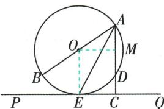

> [!success]- 必刷题
>
> > [!success] **【答案】** (1)
>
> > [!note]- **【解析】**
> > 【证明】如图,连接 OE. $\because OA = OE,$ $\therefore \angle OEA = \angle OAE.$ $\because PQ$ 切 $\odot O$ 于 E, $\therefore OE \perp PQ.$ $\because AC \perp$
> >
> > 
> >
> > $PQ, \therefore OE \parallel AC, \therefore \angle OEA = \angle EAC, \therefore \angle OAE = \angle EAC, \therefore AE$ 平分 $\angle BAC.$
> >
> > $\angle EAC, \therefore AE$ 平分 $\angle BAC.$ (2)【解】如图, 过点 O 作 $OM \perp AC$ 于 M, 则 $AM = MD = \frac{1}{2} AD. \because AD = EC = 2, \therefore AM = MD = 1.$ 又 $\because \angle OEC = \angle ACE = \angle OMC = 90^\circ, \therefore$ 四边形 $OEMC$ 为矩形, $\therefore OM = EC = 2.$ 在 Rt $\triangle AOM$ 中, $OA = \sqrt{OM^2 + AM^2} = \sqrt{2^2 + 1^2} = \sqrt{5}.$ 故 $\odot O$ 的半径为 $\sqrt{5}.$
> >
> > 再根据折叠的性质可得 $OD = DE = \frac{1}{2} OE$ ，从而可得 $OD = \frac{1}{2} OB$ 然后在Rt△ODB中，利用勾股定理进行计算，即可解答.
