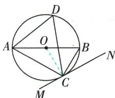

> [!success]- 必刷题
>
> > [!success] **【答案】** D
>
> > [!note]- **【解析】**
> > 如图所示, 连接 OC. ∵ 直线 MN 切 $\odot O$ 于 C 点, ∴ $\angle OCN = 90^{\circ}$ , ∴ $\angle OCB + \angle BCN = 90^{\circ}$ . ∵ OB = OC, ∴ $\angle OBC =$
> >
> > 
> >
> > 思路分析
> > 过点 O 作 $OD \perp BC$ ，垂足为 D，延长 $OD$ 交 $\widehat{BC}$ 于点 E，根据垂径定理可得
> >
> > $\angle OCB, \therefore \angle OBC + \angle BCN = 90^{\circ}.\because \angle ADC = \angle ABC, \therefore \angle ADC + \angle BCN = 90^{\circ}.\because AB$ 为 $\odot O$ 的直径， $\therefore \angle ACB = 90^{\circ}, \therefore \angle ACM + \angle BCN = 90^{\circ}.\because$ 度数之和为90度的两个角互为余角， $\therefore$ 图中与 $\angle BCN$ 互余的角有 $\angle ADC, \angle ACM, \angle OBC, \angle OCB,$ 共4个，故选D.
> >
> > 思路分析
> > 延长 CP 交 $\odot O$ 于点 K，
> > 连接 DK，根据
> > 垂径定理可得
> > CP = PK，再根
> > 据三角形中位
> > 线定理可得 $PM = \frac{1}{2} KD$ 进而可得当
> > KD 的值最大
> > 时，PM 的值
> > 最大，即当 KD
> > 为直径时，PM
> > 的值最大，即可求解.
