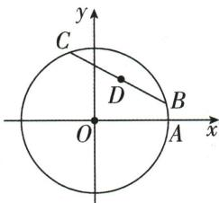
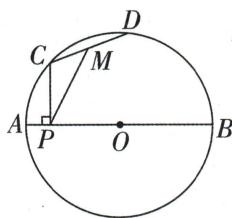

<!-- question-source:start -->
1[2024 山东淄博期中, 中]如图, 在平面直角坐标系中, 以原点 O 为圆心的圆过点 A(5,0), 一直线过点 D(2,3) 且与圆 O 交于 B, C 两点, 则弦 BC 的最小值为 \_\_\_\_.

(第1题图)

(第2题图)
<!-- question-source:end -->

![[Q00106933A1]]
