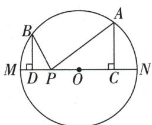
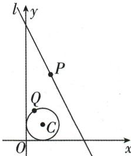

<!-- question-source:start -->
3[2025 江苏扬州质检, 中]如图, MN 为 $\odot O$ 的直径, A, B 是 $\odot O$ 上的两点, 过 A 作 $AC \perp MN$ 于点 C, 过 B 作 $BD \perp MN$ 于点 D, P 为 DC 上的任意一点, 若 MN = 20, AC = 8, BD = 6, 则 PA + PB 的最小值是
( )
A. 20 B. $14\sqrt{2}$ C. 14 D. $12\sqrt{2}$

(第3题图)

(第4题图)
<!-- question-source:end -->

![[Q00106935A1]]
