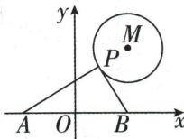

<!-- question-source:start -->
5 [中] 如图, $\odot M$ 的半径为 2, 圆心 $M$ 的坐标为 (3,4), 点 $P$ 是 $\odot M$ 上的任意一点, $PA \perp PB$ , 且 $PA, PB$ 与 $x$ 轴分别交

于 A, B 两点, 若点 A、点 B 关于原点对称, 当线段 AB 最短时, 点 A 的坐标为 \_\_\_\_.
<!-- question-source:end -->

![[Q00106937A1]]
