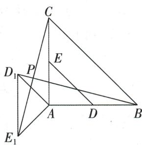
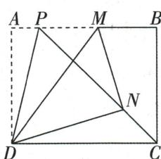

<!-- question-source:start -->
6[2024 湖北武汉洪山区校级质检, 中]在Rt△ABC中, $\angle BAC = 90^{\circ}$ , AC = AB = 4, D, E 分别是 AB, AC 的中点, 若等腰Rt△ADE 绕点 A 逆时针旋转, 得到等腰Rt△AD₁E₁, 记直线 BD₁ 与 CE₁ 的交点为 P, 则点 P 到 AB 所在直线距离的最大值为 \_\_\_\_.

(第6题图)
(第7题图)
<!-- question-source:end -->

![[Q00106938A1]]
