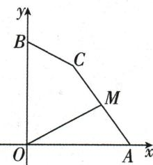
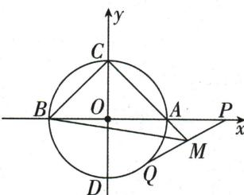

<!-- question-source:start -->
8[中]如图,点A,B的坐标分别是A(4,0),B(0,4),点C为坐标平面内一动点,BC=2,点M为线段AC的中点,连接OM,则OM的最大值为
( )
A. $\sqrt{2}+1$ B. $\sqrt{2}+\frac{1}{2}$ C. $2\sqrt{2}+1$ D. $2\sqrt{2}-\frac{1}{2}$

(第8题图)

(第9题图)
<!-- question-source:end -->

![[Q00106940A1]]
