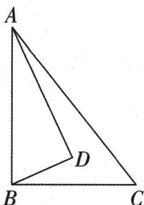
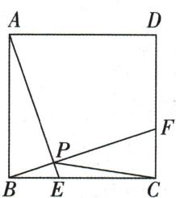

<!-- question-source:start -->
10[2024 浙江金华期中, 中]如图, 在 Rt△ABC 中, ∠ABC=90°, BC=3, AC=5, 点 D 是其内部一动点, 且 ∠DBC=∠BAD, 则 C, D 两点间的最小距离为
( )
A. 3    B. 4
C. $\sqrt{13}-2$ D. $\sqrt{13}$

(第 10 题图)

(第 11 题图)
<!-- question-source:end -->

![[Q00106942A1]]
