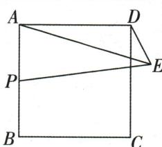

<!-- question-source:start -->
12[2024 福建福州期中, 中]如图, 正方形 ABCD 的边长为 6, 点 E 是正方形外一动点, 且点 E 在 CD 的右侧, $\angle AED = 45^{\circ}$ , P 为

AB 的中点, 连接 PE, 当 E 运动时, 线段 PE 的最大值为
A. $6\sqrt{3}$ B. $6\sqrt{2}$ C. $3+3\sqrt{3}$ D. $3+3\sqrt{2}$
<!-- question-source:end -->

![[Q00106944A1]]
