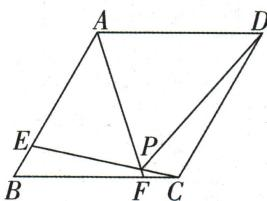

<!-- question-source:start -->
13[2025 黑龙江绥化期末,较难]如图,已知菱形ABCD中, $\angle BAD=120^{\circ}$ ,点E,F分别在AB,BC上,BE=CF,AF与CE交于点P,连接DP.
(1) 求证: $\angle APE = 60^{\circ}$ ;
(2) 当 PC = 1, PA = 5 时, 求 PD 的长;
(3) 当 $AB = 2\sqrt{3}$ 时, 求 PD 的最大值.

<!-- question-source:end -->

![[Q00106945A1]]
