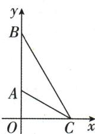

<!-- question-source:start -->
14[2024 四川宜宾翠屏区校级期中, 中]如图, 已知点 A, B 的坐标分别是 $(0,1)$ , $(0,3)$ , 点 C 为 x 轴正半轴上一动点, 当 $\angle ACB$ 最大时, 点 C 的坐标是 ( )
A. $(2,0)$ B. $(\sqrt{3},0)$ C. $(\sqrt{2},0)$ D. $(1,0)$

<!-- question-source:end -->

![[Q00106946A1]]
