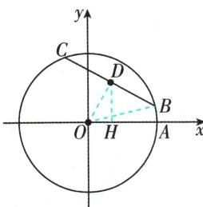

> [!success]- 必刷题
>
> > [!success] **【答案】** $4\sqrt{3}$
>
> > [!note]- **【解析】**
> > 如图, 过点 D 作 $DH \perp x$ 轴于点
> >
> > H, 连接 OD, OB, 则有 OH = 2, DH = 3, ∴ 根据勾股定理得 OD = $\sqrt{OH^{2} + DH^{2}} = \sqrt{13}$ .
> >
> > ∵ A(5,0), ∴ OA = 5,
> >
> > ∴ OB = OA = 5. ∵ 过圆
> >
> > 
> >
> > 内定点 D 的所有弦中，与 OD 垂直的弦最短，∴ 由垂径定理及勾股定理可得 BC 的长的最小值为 $2BD = 2\sqrt{OB^{2} - OD^{2}} = 2 \times \sqrt{25 - 13} = 4\sqrt{3}$ ，故答案为 $4\sqrt{3}$ .
