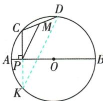
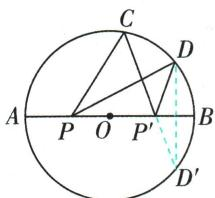

> [!success]- 必刷题
>
> > [!success] **【答案】** 4
>
> > [!note]- **【解析】**
> > 如图,延长 CP 交 $\odot O$ 于点 K,连接
> >
> > DK. $\because AB \perp CP, \therefore CP = PK.$ $\because M$ 是 $CD$ 的中点， $\therefore PM$ 是 $\triangle CKD$ 的中位线， $\therefore PM = \frac{1}{2} KD, \therefore$ 当 $KD$ 的
> >
> > 
> >
> > 值最大时, $PM$ 的值最大, 即当 $KD$ 为直径时, $PM$ 的值最大. $\because \odot O$ 的直径 $AB = 8$ , $\therefore PM$ 的最大值为 $\frac{1}{2} KD = \frac{1}{2} AB = 4$ , 故答案为 4.
> >
> > 大招解读 | 利用将军饮马模型求最值
> >
> > 已知 C, D 是 $\odot O$ 上两点，P 为直径 AB 上一动点，求 $PC + PD$ 的最小值。如图，作点 D 关于 AB 的对称点 $D'$ ，连接 $CD'$ 交 AB
> >
> > 
> >
> > 于点 $P'$ ，则 $P'D = P'D'$ ，故当点 $P$ 与点 $P'$ 重合时， $PC + PD$ 取得最小值，最小值为 $CD'$ 的长.
