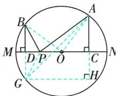

> [!success]- 必刷题
>
> > [!success] **【答案】** B
>
> > [!note]- **【解析】**
> > 如图, 连接 OA, OB. ∵ AC ⊥ MN, $BD \perp MN, \therefore OB^{2} = BD^{2} + OD^{2} = 36 + OD^{2}, OA^{2} = AC^{2} + OC^{2} = 64 + OC^{2}.$ ∵ MN = 20, A, B 是 ⊙ O 上
> >
> > $$
> > \therefore O A = O B =
> > $$
> >
> > $$
> > \frac {1}{2} M N = 1 0, \therefore 1 0 0 = 3 6 +
> > $$
> >
> > $$
> > O D ^ {2}, 1 0 0 = 6 4 + O C ^ {2}
> > $$
> >
> > 
> >
> > $$
> > \therefore O D = 8, O C = 6, \therefore C D =
> > $$
> >
> > $OD + OC = 14.$ 延长 $BD$ 与 $\odot O$ 相交于点 $G$ ，连接 $GP, AG$ . $\because MN$ 为 $\odot O$ 的直径, $BD \perp MN$ , $\therefore BD = GD = 6$ , $\therefore BP = GP$ , $\therefore PA + PB = PA + GP$ , $\therefore$ 当点 $P$ 在直线 $AG$ 上时, $PA + PB$ 取最小值, 最小值为 $AG$ 的长. 过 $G$ 作 $GH \perp AC$ 交 $AC$ 的延长线于点 $H$ . 又 $\because AC \perp MN, BD \perp MN$ , $\therefore$ 四边形 $CDGH$ 是矩形, $\therefore GH = CD = 14, CH = DG = 6$ , $\therefore AH = AC + CH = 14$ , $\therefore AG = \sqrt{AH^2 + GH^2} = \sqrt{14^2 + 14^2} = 14\sqrt{2}$ , $\therefore PA + PB$ 的最小值是 $14\sqrt{2}$ , 故选 B.
> >
> > 大招解读 利用圆外点到圆的距离求最值
> > (1) 已知直线及圆上一动点求最值, 想到过圆心作直线的垂线.
> > (2) 已知圆外一定点及圆上一动点求最值, 想到连接定点与圆心.
