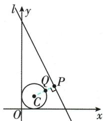

> [!success]- 必刷题
>
> > [!success] **【答案】** A
>
> > [!note]- **【解析】**
> > 如图, 过点 C 作 $CP \perp$ 直线 l 于 P 点, 交 $\odot C$ 于 Q 点, 此时 PQ 的值最小. 根据点
> >
> > ## 关键点拨
> >
> > 到直线的距离公式可知，
> > 点 $C(1,1)$ 到直线 l 的距离 $d=\frac{|-2-1+7|}{\sqrt{1+(-2)^{2}}}=\frac{4\sqrt{5}}{5}$ .
> > ∵ ⊙C 的半径为 1,
> > ∴ $PQ=\frac{4\sqrt{5}}{5}-1$ , 故选 A.
> >
> > 
> >
> > 连接 OP, 连接 OM, 交 $\odot M$ 于点 $P'$ . 根据点 M 的坐标, 利用勾股定理求出 OM 长, 再根据直角三角形斜边中线的性质, 以及关于原点对称的点的坐标特点知 AB = 2OP, 得到当线段 PO 最短时, 线段 AB 最短是解题关键.
