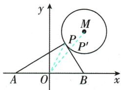

> [!success]- 必刷题
>
> > [!success] **【答案】** $(-3, 0)$
>
> > [!note]- **【解析】**
> > 如图, 连接 OP, 连接 OM, 交
> >
> > $\odot M$ 于点 $P'$ . $\because$ 点M的坐标为(3,4), $\therefore OM=\sqrt{3^{2}+4^{2}}=5. \because PA\perp PB,$ $\therefore \angle APB = 90^{\circ}. \because AO = BO, \therefore AB = 2PO. \therefore$ 当
> >
> > 
> >
> > PO 取得最小值, 即点 P 位于 $P'$ 位置时, AB 取得最小值. ∵ OM = 5, $MP' = 2$ , ∴ $OP' = 3$ , ∴ OA = 3, ∴ 点 A 的坐标为 $(-3, 0)$ , 故答案为 $(-3, 0)$ .
> >
> > ## -大招解读 | 利用直线与圆的特殊位置关系求最值
> >
> > 已知动点与定直线求最值,动点的轨迹是圆,想到利用直线与圆的位置关系,通常在相切时取得最值.
