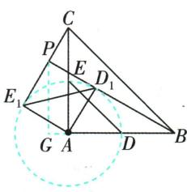

> [!success]- 必刷题
>
> > [!success] **【答案】** $1+\sqrt{3}$
>
> > [!note]- **【解析】**
> > 由题意知 $D_{1}, E_{1}$ 在以 A 为圆心, AD 为半径的圆上, 如图. 当 $BD_{1}$ 所在直线与 $\odot A$ 相切时, 直线 $BD_{1}$ 与 $CE_{1}$ 的交点 P 到直线 AB 的
> >
> > 
> >
> > 距离最大, 过点 P 作 $PG \perp AB$ 交 BA 延长线于
> >
> > 关键点拨
> > 根据题意可知, 点 C 在半径为 2 的 $\odot B$ 上运动, 通过画图可知, C 在 DB 的延长线上时, OM 的值最大, 即可求解.
> >
> > G, 此时易证四边形 $AD_{1}PE_{1}$ 是正方形, ∴ $PD_{1}=AD_{1}=\frac{1}{2}AB=2$ , 则 $BD_{1}=\sqrt{AB^{2}-AD_{1}^{2}}=\sqrt{4^{2}-2^{2}}=2\sqrt{3}$ . 在 Rt△ABD₁ 中, 易证 $\angle ABP=30^{\circ}, PB=2+2\sqrt{3}$ , 故点 P 到 AB 所在直线的距离的最大值为 $PG=\frac{1}{2}PB=1+\sqrt{3}$ , 故答案为 $1+\sqrt{3}$ .
