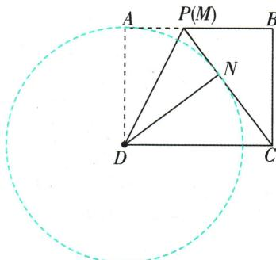
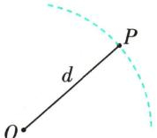

> [!success]- 必刷题
>
> > [!success] **【答案】** $10, 2\sqrt{5}$
>
> > [!note]- **【解析】**
> > 由题意可得 $\triangle CDP$ 的面积等于矩形 ABCD 面积的一半，∴ $\triangle CDP$ 的面积为 $\frac{1}{2}AB \times AD = \frac{1}{2} \times 5 \times 4 = 10$ 。在 Rt $\triangle APD$ 中， $PD = \sqrt{AD^{2} + AP^{2}} = \sqrt{16 + AP^{2}}$ ，∴ 当 AP 取最大值时，DP 有最大值。由题意可得点 N 在以 D 为圆心，4 为半径的圆弧上运动，当射线 CN
> >
> > 与圆 D 相切时, AP 的值最大, 此时 P, M 两点重合, C, N, M 三点共线, 如图. 由题意可得 AD = ND = 4, $\angle DNC =$
> >
> > 
> >
> > $\angle B = \angle DCB = 90^{\circ}, \therefore \angle NDC + \angle DCN = 90^{\circ}, \angle DCN + \angle MCB = 90^{\circ}, \therefore \angle NDC = \angle MCB.$ $\because AD = BC, \therefore DN = BC, \therefore \triangle NDC \cong \triangle BCM,$ $\therefore CN = BM = \sqrt{CD^{2} - DN^{2}} = 3, \therefore AP = AB - BP = 2, \therefore$ 在 Rt $\triangle APD$ 中， $PD = \sqrt{AD^{2} + AP^{2}} = \sqrt{4^{2} + 2^{2}} = 2\sqrt{5}$ ，故答案为 $10, 2\sqrt{5}$ .
> >
> > ## 大招解读 | 利用定点定长构造辅助圆求最值
> >
> > 
> >
> > $$
> > \mathrm{心} 、 d
> > $$
