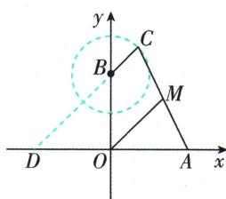
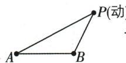

> [!success]- 必刷题
>
> > [!success] **【答案】** C
>
> > [!note]- **【解析】**
> > 如图. ∵ 点 C 为坐标平面内一动点, BC = 2, ∴ C 在以 B 为圆心, 2 为半径的圆上运动. 取 OD = OA = 4, 连接 BD. ∵ AM = CM,
> >
> > $OD = OA, \therefore OM$ 是 $\triangle ACD$ 的中位线， $\therefore OM = \frac{1}{2} CD, \therefore$ 当 $CD$ 的值最大时， $OM$ 的值最大. 当 $D, B, C$ 三点
> >
> > 
> >
> > 共线,且 C 在 DB 的延长线上时,CD 的值最大,故此时 OM 的值最大.∵ OB = OD = 4,$\angle BOD=90^{\circ},\therefore BD=4\sqrt{2},\therefore CD=4\sqrt{2}+2,$ $\therefore OM=\frac{1}{2}CD=2\sqrt{2}+1$ , 即 OM 的最大值为 $2\sqrt{2}+1$ . 故选 C.
> >
> > 
