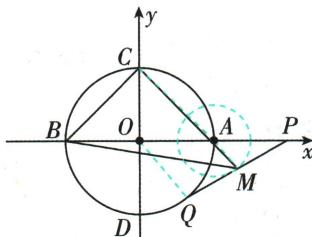
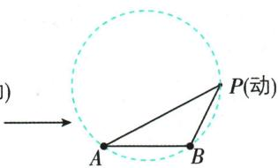

> [!success]- 必刷题
>
> > [!success] **【答案】** 16-4 $\sqrt{2}$
>
> > [!note]- **【解析】**
> > 如图, 连接 OQ, AM, AC. 由题意得 OA = OQ = AP = 4, PM = MQ, ∴ AM 是 $\triangle POQ$ 的中位线, ∴ $AM = \frac{1}{2}OQ = 2$ . ∵ AB 为 ⊙O 直径, ∴ $\angle ACB = 90^{\circ}$ . 由题意知, 点 M 在
> >
> > 以 A 为圆心,2 为半径的 $\odot A$ 上运动. 当 M 点为线段 AC 与 $\odot A$ 的交点时, 点 M 到 BC 的距离最短, 为 AC-
> >
> > 
> >
> > $2=\sqrt{4^{2}+4^{2}}-2=4\sqrt{2}-2.\because BC=\sqrt{4^{2}+4^{2}}=4\sqrt{2},\therefore\triangle BCM$ 面积的最小值为 $\frac{1}{2}BC\cdot CM=\frac{1}{2}\times4\sqrt{2}\times(4\sqrt{2}-2)=16-4\sqrt{2}$ . 故答案为16-4 $\sqrt{2}$ .
> >
> > 
> >
> > ## 思路分析
> >
> > 思路分析
> > 取 AB 的中点 O，由 $\angle DBC = \angle BAD$ 及 $\angle ABC = 90^{\circ}$ ，得出 $\angle ADB = 90^{\circ}$ ，可得 D 点在以 O 为圆心，OA 为半径的圆弧上运动，连接 OC 交 $\odot O$ 于点 $D'$ ，当 $D, D'$ 重合时，C, D 间
> >
> > 如图,固定线段AB所原理:弦AB所对的同对动角 $\angle P$ 为定值,侧圆周角恒相等.
> > 则点P运动轨迹为过
> > A,B,P三点的圆. 备注:点P在优弧、劣弧上运动皆可.
