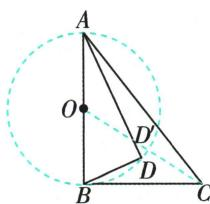

> [!success]- 必刷题
>
> > [!success] **【答案】** C
>
> > [!note]- **【解析】**
> > ∵ Rt $\triangle ABC$ 中， $\angle ABC = 90^{\circ}$ ，的距离最小.
> > BC = 3, AC = 5, ∴ 由勾股定理, 得 AB =
> >
> > $\sqrt{AC^{2}-BC^{2}}=\sqrt{5^{2}-3^{2}}=4.$ 如图，取 AB 的中点 O. $\because \angle DBC = \angle BAD, \angle DBC + \angle ABD = 90^{\circ}, \therefore \angle BAD + \angle ABD = 90^{\circ}, \therefore \angle ADB =$
> >
> > 
> >
> > $90^{\circ}, \therefore D$ 点在以 $O$ 为圆心, $OA$ 为半径的圆弧上运动. 连接 $OC$ 交 $\odot O$ 于点 $D'$ , 连接 $OD, DC$ . 当点 $D$ 与点 $D'$ 重合时, $C, D$ 间的距离最小, 为 $CD'$ 的长, 此时 $OD' = OB = \frac{1}{2} AB = 2$ . 在 Rt $\triangle OCB$ 中, 由勾股定理, 得 $OC = \sqrt{BC^{2} + OB^{2}} = \sqrt{3^{2} + 2^{2}} = \sqrt{13}$ , 故 $CD$ 的最小值为 $OC - OD' = \sqrt{13} - 2$ , 故选 C.
> >
> > 关键点拨
> > (3)先证明 A,
> > P, C, D 四点共圆,则当 PD 为直径时,PD 的值最大,设圆心为 O,连接 AC, OA, OC,过点 O 作 OM⊥AC 于 M,在 Rt△AOM 中求出 OA 的长即可得到答案.
