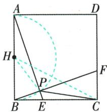
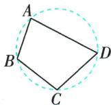
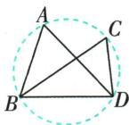

> [!success]- 必刷题
>
> > [!success] **【答案】** A
>
> > [!note]- **【解析】**
> > 如图, 取 AB 中点 H, 连接 HP, HC. 在正方形 ABCD 中, AB = BC, $\angle ABC =$
> >
> > $\angle BCD = 90^{\circ}$ .在 $\triangle ABE$ 和 $\triangle BCF$ 中， $\left\{ \begin{array}{ll}AB = BC,\\ \angle ABE = \angle BCF,\\ BE = CF, \end{array} \right.$ $\therefore \triangle ABE\cong \triangle BCF$
> >
> > 
> >
> > (SAS), $\therefore \angle BAE = \angle CBF, \therefore \angle BAE + \angle ABP = \angle CBF + \angle ABP = 90^{\circ}, \therefore \angle APB = 90^{\circ}, \therefore HP = \frac{1}{2} AB = 2, \therefore$ 点 $P$ 在以点 $H$ 为圆心，以 $HP$ 为半径的半圆上运动， $\therefore$ 当 $H, P, C$ 三点在同一条直线上时， $CP$ 取最小值。在 Rt $\triangle BCH$ 中， $HC = \sqrt{2^{2} + 4^{2}} = 2\sqrt{5}, \therefore CP$ 的最小值为 $HC - HP = 2\sqrt{5} - 2$ ，故选 A.
> >
> > ## 大招解读 | 利用四点共圆求最值
> >
> > 
> >
> > 
> >
> > 对角互补型： 同侧等角型：
> > 如图, 若 $\angle A + \angle C = 180^{\circ}$ 如图, 若 $\angle A = \angle C$ ,
> > 或 $\angle B + \angle D = 180^{\circ}$ ，则则 A, B, C, D 四点
> > A, B, C, D 四点共圆. 共圆.
