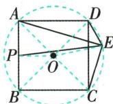

> [!success]- 必刷题
>
> > [!success] **【答案】** D
>
> > [!note]- **【解析】**
> > 如图, 连接 AC, BD 交于点 O, 连接 PO, EO.
> > ∵ $\angle AED = 45^{\circ}$ , $\angle ACD = 45^{\circ}$ ,
> > ∴ A, C, E, D 四点共圆. ∵ 正
> >
> > 
> >
> > 方形 ABCD 的边长为 6, ∴ $BD = \sqrt{6^{2} + 6^{2}} = 6\sqrt{2}$ , ∴ $OE = OD = \frac{1}{2}BD = 3\sqrt{2}$ . ∵ P 为 AB 的中点, O 是 BD 的中点, ∴ $OP = \frac{1}{2}AD = 3$ .
> >
> > ∵ $PE \leqslant OP + OE = 3 + 3\sqrt{2}$ , ∴ 当 P, O, E 三点共线时, PE 的值最大, $PE = OP + OE = 3 + 3\sqrt{2}$ , 即线段 PE 的最大值为 $3 + 3\sqrt{2}$ .
> >
> > 故选 **D**.
