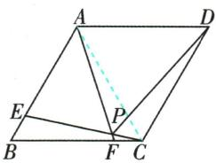
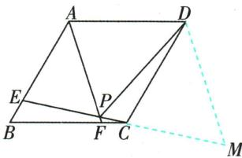
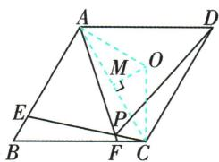
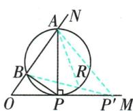

> [!success]- 必刷题
>
> > [!success] **【答案】** (1)
>
> > [!note]- **【解析】**
> > 【证明】如图(1)所示,连接AC.∵四边形ABCD是菱形,∴AB=BC,AD∥BC,AB∥CD.∵∠BAD=120°,∴∠B=∠ADC=60°,∴△ABC是等边三角形,∴∠ACF=∠CBE=60°,AC=CB.又∵CF=BE,∴△ACF≌△CBE(SAS),∴∠CAF=∠BCE,∴∠APE=∠ACE+∠CAF=∠BCE+∠ACE=∠ACB=60°.
> >
> > 
> > 图(1)
> >
> > 
> > 图(2)
> >
> > 【解】(2)如图(2)，延长PC到M，使得CM=AP，连接DM.由(1)易得 $\angle AFC=\angle CEB$ .
> > ∵菱形 ABCD 中， $AD \parallel BC$ ， $AB \parallel CD$ ，
> > ∴ $\angle DAF + \angle AFC = 180^{\circ}$ ， $\angle DCM = \angle AEC$ ∴ $\angle CEB + \angle DAF = 180^{\circ}$ . ∵ $\angle AEC + \angle CEB = 180^{\circ}$ , ∴ $\angle DAF = \angle AEC = \angle DCM$ . 又∵ AP = CM, AD = CD, ∴ $\triangle ADP \cong \triangle CDM$ (SAS),
> > ∴ DP = DM, $\angle ADP = \angle CDM$ , ∴ $\angle ADC = \angle PDM$ . ∵ $\angle ADC = 60^{\circ}$ , ∴ $\angle PDM = 60^{\circ}$ ,
> > ∴ $\triangle PDM$ 是等边三角形，∴ PD = PM = PC + CM = PC + PA = 6.
> >
> > 关键点拨
> > 解决本题的关键是要掌握正多边形的概念,各边相等且各角也相等的多边形是正多边形.
> >
> > (3) $\because \angle APE=60^{\circ},$ $\therefore \angle APC = 120^{\circ}.$ $\because \angle ADC = 60^{\circ},$ $\therefore \angle APC + \angle ADC = 180^{\circ}, \therefore A, P, C, D$ 四点共圆，∴ 当 PD 为直
> >
> > 
> > 图(3)
> >
> > 径时, $PD$ 的值最大. 连接 $AC$ , 设圆心为 $O$ , 连接 $OA, OC$ , 过点 $O$ 作 $OM \perp AC$ 于 $M$ , 如图(3), $\therefore \angle AOC = 2\angle ADC = 120^{\circ}$ . $\because$ 菱形 $ABCD$ 中, $OA = OC$ , $\therefore \angle OAM = 30^{\circ}$ , $\therefore OA = 2OM$ . $\because AC = AB = 2\sqrt{3}, OM \perp AC, \therefore AM = \frac{1}{2} AC = \sqrt{3}, \therefore OM^{2} + AM^{2} = (2OM)^{2}$ , 解得 $OM = 1$ , $\therefore OA = 2, \therefore PD$ 的最大值为4.
> >
> > ## 大招解读 | 利用米勒定理求最值
> >
> > 已知点 $A, B$ 是 $\angle MON$ 的边 $ON$ 上的两个定点，点 $P$ 是边 $OM$ 上的一个动点，则当且仅当 $\triangle ABP$ 的外接圆与边 $OM$ 相切于点 $P$ 时， $\angle APB$ 最大.
> >
> > 
> >
> > 证明:如图,在边 OM 上任取一点 $P'$ (不与 P 点重合), 连接 $AP', BP', BP'$ 与圆相交于点 R, 连接 AR, $\therefore \angle APB = \angle ARB > \angle AP'B$ (利用三角形外角性质),
> > ∴ 当圆与 OM 相切时, $\angle APB$ 最大.
