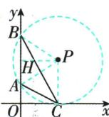

> [!success]- 必刷题
>
> > [!success] **【答案】** B
>
> > [!note]- **【解析】**
> > 过点 A, B 作 $\odot P$ ，当 $\odot P$ 与 x 轴相切于点 C 时， $\angle ACB$ 最大，连接 PA, PB, PC，作 $PH \perp y$ 轴于 H，如图。∵ 点 A, B 的坐标分别是 (0,
> >
> > 
> >
> > $$
> > 1), (0, 3), \therefore O A = 1, A B = 3 - 1 = 2. \because P H \perp
> > $$
> >
> > 关键点按
> > 掌握正五边形
> > 外角和为
> > 360°是解题
> > 关键.
> >
> > $AB, \therefore AH = BH = 1, \therefore OH = 2.\because \odot P$ 与 $x$ 轴相切于点 $C, \therefore PC \perp x$ 轴， $\therefore$ 四边形 $PCOH$ 为矩形， $\therefore PC = OH = 2, \therefore PA = 2.$ 在 Rt $\triangle PAH$ 中， $PH = \sqrt{PA^2 - AH^2} = \sqrt{2^2 - 1^2} = \sqrt{3}, \therefore C$ 点坐标为 $(\sqrt{3}, 0)$ . 故选 B.
> >
> > ## 24.3 正多边形和圆
