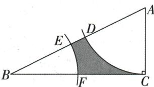

<!-- question-source:start -->
1[中]如图,在 Rt△ABC 中,∠ACB=90°,AB=√5,BC=2,以点A为圆心,AC的长为半径画弧,交AB于点D,以点B为圆心,AC的长为半径画弧,交AB于点E,交BC于点F,则图中阴影部分的面积为()

A. $8 - \pi$ B. $4 - \pi$ C. $2 - \frac{\pi}{4}$ D. $1 - \frac{\pi}{4}$
<!-- question-source:end -->

![[Q00106980A1]]
