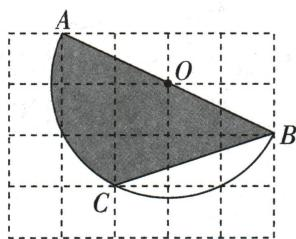

<!-- question-source:start -->
2[2025 山西晋中期中, 中]如图是 $5 \times 4$ 的小正方形网格, 小正方形的边长为 2, 点 A 和点 B 是格点, 连接 AB, 小明在网格中画出以 AB 为直径的半圆, 圆心为点 O, 点 C 是格点且在半圆 O 上, 连接 BC, 则图中阴影部分的面积是 ( )

A. $5\pi + 10$ B. $4\pi - 9$ C. $\frac{5\pi - 5}{4}$ D. $\frac{5\pi + 10}{4}$
<!-- question-source:end -->

![[Q00106981A1]]
