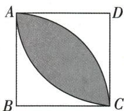
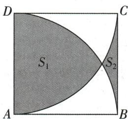

<!-- question-source:start -->
5 如图, 正方形 ABCD 中, 分别以 B, D 为圆心, 以正方形的边长 a 为半径画弧, 形成树叶形 (阴影部分) 图案, 则树叶形图案的面积为 ( )

A. $\frac{1}{4}\pi a^{2}-\frac{1}{4}a^{2}$ B. $\frac{1}{2}\pi a^{2}-a^{2}$ C. $\frac{1}{4}\pi a^{2}-\frac{1}{2}a^{2}$ D. $\frac{1}{3}\pi a^{2}-\frac{1}{2}a^{2}$

(第5题图)

(第6题图)
<!-- question-source:end -->

![[Q00106984A1]]
