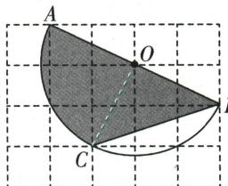
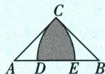

> [!success]- 必刷题
>
> > [!success] **【答案】** A
>
> > [!note]- **【解析】**
> > 如图所示, 连接 CO. ∵ 小正方形
> >
> > 的边长为 2, ∴ OC = OB = $\sqrt{4^{2} + 2^{2}} = 2\sqrt{5}$ , $BC=\sqrt{2^{2}+6^{2}}=2\sqrt{10}$ ∴ $OC^{2} + OB^{2} = BC^{2}$ ∴ $\angle COB = 90^{\circ} =$
> >
> > 
> >
> > $\angle AOC, \therefore$ 图中阴影部分的面积是 $S_{\triangle COB} + S_{扇形AOC} = \frac{1}{2} \times (2\sqrt{5})^2 + \frac{90\pi \times (2\sqrt{5})^2}{360} = 5\pi + 10.$ 故选A.
> >
> > 大招解读|等积转化法
> > 适用情形:①图中某些空白部分可通过对称、旋转等使之和部分阴影面积相等,进而将阴影部分转化为规则图形;
> > - **②**：利用全等的三角形、同底等高的三角形面积相等转化.
> >
> > 关键点拨
> > 全等的两个三角形的面积相等.
> >
> > ## 归纳总结
> >
> > 有的阴影部分面积是由两个基本图形相互重叠得到的，此时求阴影部分面积常用的方法：两个基本图形的面积之和-组合图形的面积=阴影部分面积.如下图等腰 $\triangle ABC$ 中， $S_{阴影}=2S_{扇形ACE}-S_{\triangle ABC}$ .
> >
> > 
