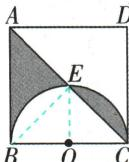

> [!success]- 必刷题
>
> > [!success] **【答案】** A
>
> > [!note]- **【解析】**
> > 如图, 设 AC 与半圆交于点 E, 半圆的圆心为 O, 连接 BE, OE. ∵ 四边形 ABCD 是
> >
> > 正方形， $\therefore \angle OCE = 45^{\circ}$ $\because OE = OC, \therefore \angle OEC = \angle OCE = 45^{\circ},$ $\therefore \angle EOC = 90^{\circ}, \therefore OE$ 垂直平分 $BC, \therefore BE = CE, \therefore$ 弓形 $BE$ 的面积 $=$ 弓形 $CE$ 的面积， $\therefore S_{\text{阴影部分}} - S_{\triangle ABC} - S_{\triangle BCE} = \frac{1}{2} \times 6 \times 6 - \frac{1}{2} \times 6 \times 3 = 9$
> >
> > 
> >
> > $$
> > \therefore S _ {\text { 阴影部分 }} = S _ {\triangle A B E} =
> > $$
