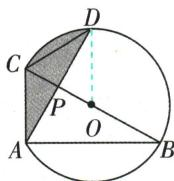
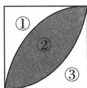

> [!success]- 必刷题
>
> > [!success] **【答案】** $\frac{2}{3}\pi
>
> > [!note]- **【解析】**
> > $\because \mathrm{Rt} \triangle ABC$ $\angle BAC = 90^{\circ}, \therefore BC$ 是直径.
> > 设 $BC$ 的中点为 $O$ . 如图, 连接 $OD$ . $\because \angle BAC = 90^{\circ}, \angle ABC = 30^{\circ}, AC = 2, \therefore BC = 2AC = 4$ . $\because CD = CA, \therefore CD =$
> >
> > $$
> > \widehat {A B C}
> > $$
> >
> > 
> >
> > CO. $\because CO = DO, \therefore \triangle COD$ 是等边三角形， $\therefore \angle COD = \angle CDO = 60^{\circ}.$ $P$ 是线段 $BC$ 上的动点，当点 $A, P, D$ 共线时， $PA + PD$ 的值最小，此时 $\angle CAD = \angle CDA = 30^{\circ}, \therefore \angle ADO = 30^{\circ}$ . 在 $\triangle APC$ 和 $\triangle DPO$ 中， $\left\{ \begin{array}{l} \angle CAP = \angle PDO, \\ \angle APC = \angle DPO, \\ AC = OD, \end{array} \right.$ $\therefore \triangle APC \cong \triangle DPO(AAS), \therefore S_{\text{阴影}} = S_{\text{扇形}COD} = \frac{60\pi \times 2^{2}}{360} = \frac{2}{3}\pi,$ 故答案为 $\frac{2}{3}\pi.$
> >
> > 大招解读 | 容斥原理法
> > 这类题阴影部分一般是由几个图形叠加而成,求解时把所求阴影部分的面积问题转化为可求面积的规则图形的重叠部分的面积问题,
> >
> > 
> >
> > 然后运用“容斥原理”解决. 如图, 求阴影部分的面积: $S_{①} + S_{②} + S_{②} + S_{③} = \frac{1}{2} S_{\text {圆}}, S_{①} + S_{②} + S_{③} = S_{\text {正方形}}, S_{\text {阴影}} = S_{②} = \frac{1}{2} S_{\text {圆}} - S_{\text {正方形}}.$
