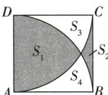

> [!success]- 必刷题
>
> > [!success] **【答案】** A
>
> > [!note]- **【解析】**
> > 如图. $S_{正方形} = S_{1} + D$ $S_{2} + S_{3} + S_{4}$ ，①两个扇形的面积和为 $2S_{扇形} = 2S_{1} + S_{3} + S_{4}$ ，②
> > - **②**：-①，得 $S_{1} - S_{2} = 2S_{扇形} - A$ $S_{正方形} = \frac{90\pi \times 1^{2} \times 2}{360} - 1 = \frac{\pi}{2} - 1$ 。故选
> >
> > 
