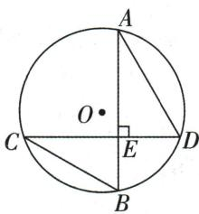
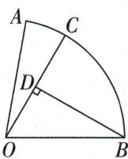

<!-- question-source:start -->
2[2025 江苏宿迁质检]如图,在半径为6的 $\odot O$ 中,弦 $AB\perp CD$ 于点E,若 $\angle A=30^{\circ}$ ,则劣弧 $\widehat{AC}$ 的长为
A. $8\pi$ B. $5\pi$ C. $4\pi$ D. $6\pi$

(第2题图)

(第3题图)
<!-- question-source:end -->

![[Q00106960A1]]
