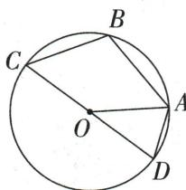

<!-- question-source:start -->
6 如图, 四边形 ABCD 内接于半径为 3 的 $\odot O$ , CD 是直径, 若 $\angle ABC = 110^{\circ}$ , 则扇形 AOD 的面积为 ( )
A. $\frac{7}{4}\pi$ B. $\pi$ C. $\frac{7}{2}\pi$

D. $2 \pi$
<!-- question-source:end -->

![[Q00106964A1]]
