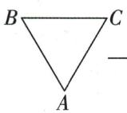
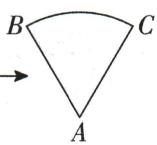
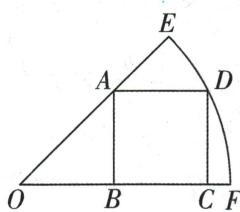

<!-- question-source:start -->
7[2024 河北邯郸校级期中]如图(1)是边长为1的等边三角形铁丝框 ABC, 按图(2)方式变形成以 A 为圆心, AB 长为半径的扇形(图形周长保持不变), 则所得扇形 ABC 的面积为 \_\_\_\_.

图(1)
图(2)

(第7题图)
(第8题图)
<!-- question-source:end -->

![[Q00106965A1]]
