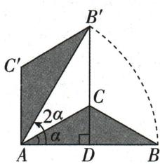
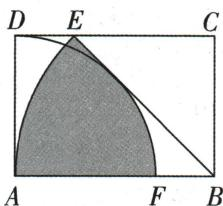

<!-- question-source:start -->
1[中]如图,在 $\triangle ABC$ 中, $CA=CB=4$ , $\angle BAC=\alpha$ ,将 $\triangle ABC$ 绕点 $A$ 逆时针旋转 $2\alpha$ ,得到 $\triangle AB'C'$ ,连接 $B'C$ 并延长交 $AB$ 于点 $D$ ,当 $B'D\perp AB$ 时, $\widehat{BB'}$ 的长是
( )
A. $\frac{2\sqrt{3}}{3}\pi$ B. $\frac{4\sqrt{3}}{3}\pi$ C. $\frac{8\sqrt{3}}{9}\pi$ D. $\frac{10\sqrt{3}}{9}\pi$

(第1题图)

(第2题图)
<!-- question-source:end -->

![[Q00106968A1]]
